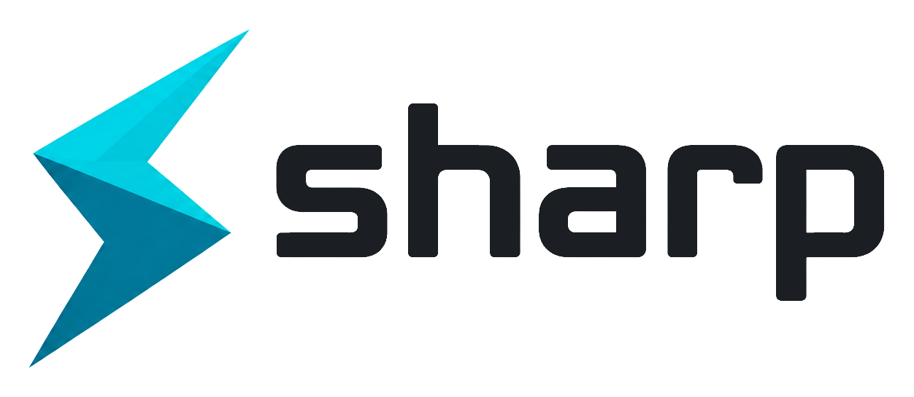

  
<a name="logo"/>    
<div align="center">    
<a href="https://github.com/" target="_blank">    
</img>    
</a>    
</div>    
    
# The Sharp Programming Language 

Sharp is an open source a modern object-oriented programming language 
that was designed to improve the speed and efficiency when writing robust software.     
    
Sharp's syntax design is elegantly simple and easy to read. Allowing you to focus more on what the code
is doing rather than how to write the code.   
```javascript    
// Ths is a hello world program!
mod app;    
    
// lets say hi 3 times!
def main() {    
   print("hello, world!");    
}    
```  

Sharp is the first ever object-orientated language to offer a built-in high performance
dependency injection system.

```javascript
mod main;

class user_client {
    def create(name: string) {
        println("created $name!");
    }   
}

class user_api {
    private client: user_client;
        
    user_api(uc: user_client) {
        client = uc;
    }

    def create_user(name: string) {
        client.create(name);
    }
}

// inject value of user client into global variable
inject api : user_api;

def main() {
    // use the Api!
    api.create_user("james");
}

// create a component for the user api
component user_component {
    single { new user_api(get()) }
    factory { new user_client() }
}

``` 


The standard library comes with a comprehensive lightweight co-routines library
that makes handling work in the background simple to put together but looks good as well.
  
```javascript  
mod app; 

// import the threadding library
import (
    std.io.coroutines
)
  
def heavy_computation() {
    // simulate heavy work being done
    delay(3000);
}

def lots_of_math() : int {
    // simulate heavy work being done
    delay(1000);
    return 6;
}

def main() {  
    // here we create a background task to do some work
   launcher = { -> 
        heavy_computation();
   };

   // launch a task that you can get the answer at a later time
    answer := deferred_task<int>.for_result({ observer ->
            observer.post(lots_of_math());
        }
    );
    
   println("you're answer is ${answer.await()}"); // block main thread until answer is posted
}  
```  


The language also supports several other convenient features that improve 
the overall experience with programming in the language.

```javascript
mod app;
  
class list<T> {
    // inferred type system using `:=`
    size := 0;
    data : T[];
}

/*
* Extension functions
*/
def list.last() : T {
    return data[size-1];
}


/*
* Function pointers
*/
def main() { /* ... */ }
main_ref := main;

/*
* inline function declarations
*/
count := 1;
def inc_count() := count++;

/*
* Type aliasing
*/
alias var as Dollar
money : Dollar = 1.52;

/*
* Anonymous arrays
*/
num_list := { 1, 2, 3 };

/*
* Typed Dictionaries
*/
response_messages := { as <int, string>
    200 : "200 error",
    500 : "500 Error",
    405 : "405 Error"    
};

/*
* Anonymous Dictionaries
*/
days := {
    0 : "Monday",
    1 : "Tuesday",
    2 : "Wednesday",
    3 : "Thursday",
    4 : "Friday",
    5 : "Saturday",
    6 : "Sunday"
};


/*
* Anonymous functions
*/
total_size := { items : int[] -> (int)
    total := 0;
    foreach(item in items) {
        total += item;
    }
    
    return total;
};

/*
* Class mutations
*
* Class list now has the field initialSize
* and constructor, class mutation acts just like
* an advanced version of extension functions
*/
mutate class list {
    initialSize : var = 100;
    
    List(data : T[]) {
        // ...
    }   
}
// and so much more !!
```

Sharp has a multi-language inspired syntax taking the beauty of languages such 
as JavaScript, python, Java, lua, Go, and C#. While expressing it in a more concise way. 


## Getting Started

#### Installing

Download the newest `sharp-<version>.zip` from the [`releases`](releases) folder and unpack it.
`START-HERE.txt` inside says the same as below.

**Windows** - double-click `windows\win-install.cmd` (or run it in a terminal).

**Linux (64-bit x86)**

```
bash linux/unix-install.sh
```

**Raspberry Pi, or any other Linux** - the VM is built on the machine itself:

```
git clone https://github.com/AndroDevcd/Sharp.git
cd Sharp
bash build-scripts/linux/install_from_source.sh
```

Then open a NEW terminal and try it:

```
sharpc hello.sharp -o hello
sharp hello
```

(`hello.sharp` is in the `examples` folder of the install.)

#### Building from source

[`build-scripts/README.md`](build-scripts/README.md) explains how to build Sharp, run its tests and
make a release. The short form, in Linux or WSL:

```
bash build-scripts/build.sh
bash build-scripts/test.sh
```

#### Programming Ideas
After you install Sharp if you are having trouble coming up with programming ideas then you can head over to the 'examples/' directory to see a list
of sample programs using various parts of the Sharp programming language.

